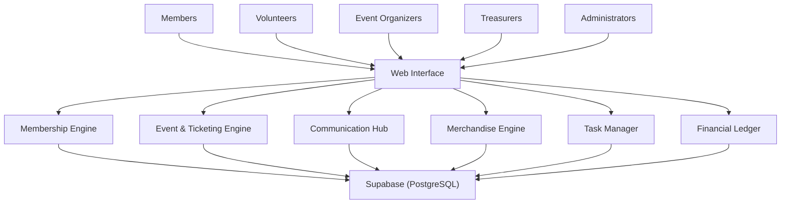
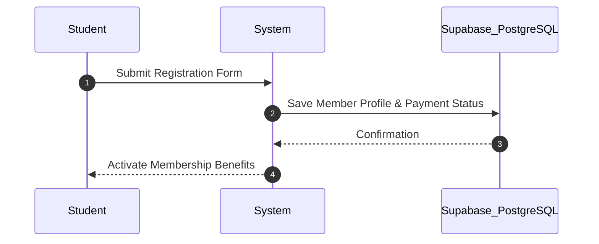
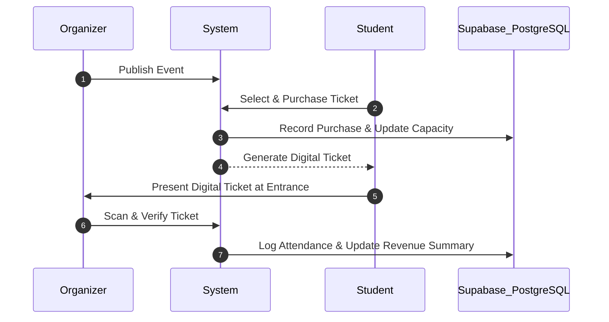
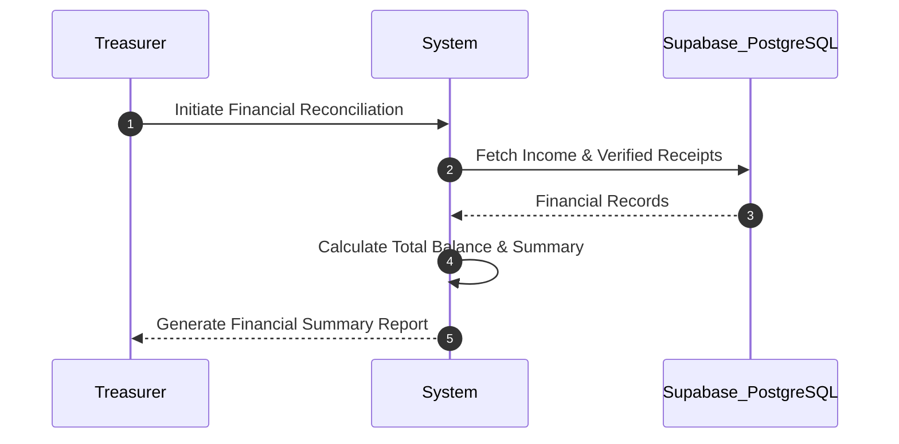

<div align="center">

# 🏛️ Skyline Student Association
### 🎓 Student Organization System

*A unified platform to manage student memberships, events, ticket sales, merchandise, announcements, volunteer tasks, and finances in one place.*

[](docs/VERIFICATION.md)
[](#-technology-stack)
[](#-core-features)
[](docs/PROJECT_WALKTHROUGH.md)

---

[Overview](#-overview) • [Problem Statement](#-problem-statement) • [Core Features](#-core-features) • [Target Users](#-target-users) • [Architecture](#-system-architecture) • [Workflows](#-typical-user-workflows) • [Setup](#-setup--getting-started)

---

</div>

## 📌 Overview

The **Skyline Student Association** is a campus club that organizes events, sells memberships and merchandise, and manages a budget funded by membership dues, ticket sales, and fundraisers.

Currently, most operations are handled manually using spreadsheets, notebooks, cash payments, and WhatsApp messages. This leads to missed announcements, financial discrepancies, and difficulty tracking memberships, payments, and expenses.

The **Student Organization System** aims to digitize and centralize these operations, making club management simpler, faster, and more transparent.

---

## 🎯 Problem Statement

The association faces several operational challenges:

| Operational Area | Existing Manual Challenge | Digitized Solution |
| :--- | :--- | :--- |
| 🪪 **Membership Management** | Member details and dues are tracked in spreadsheets. | Centralized database with automated renewal reminders. |
| 🎟️ **Event Management** | Tickets are sold manually, making attendance & revenue difficult to track. | Online ticket sales, member discounts & entrance verification. |
| 📢 **Communication** | Announcements sent individually across multiple WhatsApp groups. | Centralized broadcast hub with historical timestamped logs. |
| 👕 **Merchandise Sales** | Orders, sizes, payments, and inventory tracked manually. | E-commerce style order tracking with real-time stock updates. |
| 🤝 **Volunteer Coordination** | Tasks and responsibilities scattered across group chats. | Structured task assignment, deadlines & progress tracking. |
| 💰 **Financial Management** | Income, expenses & reimbursements recorded in notebooks with loose receipts. | Central ledger with receipt attachments & automated balance calculations. |

The system will provide a single platform to address these problems.

---

## ✨ Core Features

<details open>
<summary><b>1. 🪪 Membership Management</b></summary>

- Register and manage student members.
- Track membership status and dues payments.
- Define membership benefits, including discounts on tickets and merchandise.
- Manage annual membership validity and renewals.
- Send renewal reminders before memberships expire.
- Verify membership status during events.
</details>

<details open>
<summary><b>2. 🎟️ Event and Ticket Management</b></summary>

- Create and publish events online.
- Sell tickets with different pricing for members and non-members.
- Set ticket limits and track remaining availability.
- Generate digital tickets for attendees.
- Verify tickets quickly at the event entrance.
- Track attendance and ticket check-ins.
- Generate event revenue and attendance reports.
</details>

<details open>
<summary><b>3. 📢 Announcements and Communication</b></summary>

- Publish announcements through a centralized website.
- Maintain a mailing list for members.
- Send updates about meetings, deadlines, and schedule changes.
- Keep a history of published announcements with timestamps.
- Reduce the need to send messages manually across multiple groups.
</details>

<details open>
<summary><b>4. 👕 Merchandise Management</b></summary>

- List and sell club merchandise, including hoodies and T-shirts.
- Collect orders and payments online.
- Record product sizes and quantities.
- Track available stock for each product and size.
- Update inventory as orders are placed.
- Monitor merchandise sales and revenue.
</details>

<details open>
<summary><b>5. 🤝 Volunteer and Task Management</b></summary>

- Create tasks for events and fundraisers.
- Assign tasks to volunteers.
- Set deadlines and track task status.
- View task ownership and progress at a glance.
- Coordinate activities without relying entirely on group chats.
- Track fundraiser preparation and completion.
</details>

<details open>
<summary><b>6. 💰 Financial Management</b></summary>

- Record income from membership dues, ticket sales, merchandise, and fundraisers.
- Record expenses incurred by the association.
- Submit and track volunteer reimbursement requests.
- Attach receipts to expense records.
- Track reimbursement status.
- View total income, total expenses, and available balance.
- Generate financial summaries for the semester.
- Maintain transparent financial records for the leadership team.
</details>

---

## 👥 Target Users

| Role | Key Responsibilities & Capabilities |
| :--- | :--- |
| 👤 **Members** | Register, renew memberships, purchase tickets, order merchandise, and receive announcements. |
| 🙋 **Volunteers** | View assigned tasks, manage responsibilities, and submit expense claims. |
| 🗓️ **Event Organizers** | Create events, manage tickets, and track attendance. |
| 💼 **Treasurers** | Monitor income, expenses, reimbursements, and the club's balance. |
| 👑 **Administrators / Club Leaders** | Manage members, events, announcements, merchandise, volunteers, and overall club operations. |

---

## 🏛️ System Architecture

```text
+-----------------------------------------------------------------------------------+
|                                 USER ROLES & ACCESS                               |
|   [ Members ]  [ Volunteers ]  [ Event Organizers ]  [ Treasurers ]  [ Leaders ]  |
+-----------------------------------------------------------------------------------+
                                         |
                                         v
+-----------------------------------------------------------------------------------+
|                        CENTRALIZED APPLICATION PLATFORM                           |
|                       (Web Interface & Unified Dashboard)                         |
|                                                                                   |
|  +---------------------+  +---------------------+  +---------------------------+  |
|  |  Membership Engine  |  |  Event & Ticketing  |  |  Communication Hub        |  |
|  +---------------------+  +---------------------+  +---------------------------+  |
|  |  Merchandise/Stock  |  |  Task & Volunteers  |  |  Financial Ledger         |  |
|  +---------------------+  +---------------------+  +---------------------------+  |
+-----------------------------------------------------------------------------------+
                                         |
                                         v
+-----------------------------------------------------------------------------------+
|                             DATA & PERSISTENCE LAYER                              |
|         [( Supabase - PostgreSQL Database )]      [ Receipts & Ticket Files ]     |
+-----------------------------------------------------------------------------------+
```

<details>
<summary><b>View Mermaid Diagram Format</b></summary>


</details>

---

## 🔄 Typical User Workflows

### 1. New Member Registration
1. A student registers for membership.
2. The system records their details and payment status.
3. Membership benefits become available once eligibility requirements are met.
4. The system tracks the membership expiry date and sends renewal reminders.

```text
[ Student ] ---> ( 1. Submit Registration ) ---> [ Application Server ]
                                                        |
                                            ( 2. Save Profile & Payment )
                                                        v
[ Activate Benefits ] <--- ( 3. Benefits Active ) <--- [ Supabase (PostgreSQL) ]
```

<details>
<summary><b>View Mermaid Diagram Format</b></summary>


</details>

---

### 2. Event Ticket Purchase
1. An organizer publishes an event and configures ticket prices and capacity.
2. A student selects the appropriate ticket type.
3. The system processes the purchase and generates a digital ticket.
4. An organizer verifies the ticket at the entrance.
5. Attendance and event revenue are recorded.

```text
[ Event Organizer ] ---> ( 1. Publish Event ) -------> [ Application Server ]
                                                               |
[ Student ] ------------> ( 2. Purchase Ticket ) ------------> |
                                                               |
[ Digital Ticket ] <----- ( 3. Issue Ticket ) <----------------+ ( 4. Update Inventory )
                                                                         |
                                                                         v
[ Entrance Scan ] ------> ( 5. Verify Ticket ) --------------> [ Supabase (PostgreSQL) ]
```

<details>
<summary><b>View Mermaid Diagram Format</b></summary>


</details>

---

### 3. Merchandise Order
1. An administrator lists products, sizes, prices, and stock.
2. A member selects merchandise and places an order.
3. The system records payment and updates inventory.
4. The order is tracked until fulfilment.

---

### 4. Fundraiser Coordination
1. An organizer creates a fundraiser and its associated tasks.
2. Tasks are assigned to volunteers with deadlines.
3. Volunteers update their task progress.
4. The organizer monitors completion and fundraiser progress.
5. Income and expenses are recorded in the financial system.

---

### 5. Semester-End Financial Reporting
1. The treasurer reviews all recorded income.
2. Expenses and reimbursement requests are reconciled with receipts.
3. The system calculates total income, total expenses, and the remaining balance.
4. A financial summary is generated for review by the leadership team.

```text
[ Treasurer ] ----------> ( 1. Request Reconciliation ) ----> [ Application Server ]
                                                                       |
                                                           ( 2. Fetch Ledger & Receipts )
                                                                       v
[ Summary Report ] <----- ( 3. Deliver Report ) <------------- [ Supabase (PostgreSQL) ]
```

<details>
<summary><b>View Mermaid Diagram Format</b></summary>


</details>

---

## 🛠️ Technology Stack

| Component Layer | Technology / Implementation | Function |
| :--- | :--- | :--- |
| **Frontend UI** | HTML5 / CSS3 / JavaScript | Responsive dashboard, event catalog, forms & announcements |
| **Backend Core** | Python Web Framework | Role-switching, business logic execution & task routing |
| **Database** | **Supabase (PostgreSQL)** | Relational database persistence for members, tickets, stock & finances |
| **Documentation** | GitHub Markdown & Mermaid.js | Dynamic workflows, verification matrix & walkthrough guides |

---

## 📁 Repository Structure

```text
Commit/
├── skyline/                         # Core practice application module
│   ├── README.md                    # Skyline application instructions
│   ├── app.py                       # Main application entrypoint
│   ├── models/                      # Data models & Supabase DB client logic
│   ├── templates/                   # HTML view templates
│   └── static/                      # Custom CSS styles, JS & assets
│
├── docs/                            # Project documentation & verification
│   ├── PROJECT_WALKTHROUGH.md       # Beginner-friendly guide & remaining work
│   └── VERIFICATION.md              # Completed verification matrix & blockers
│
└── README.md                        # Master System README (You are here)
```

---

## 💡 Expected Benefits

- ⚡ **Centralized Management:** All club operations under one unified platform.
- 📉 **Reduced Administrative Overhead:** Eliminates manual data entry across multiple spreadsheets.
- 🪪 **Accurate Membership Tracking:** Automated validity monitoring and timely renewal notifications.
- 🎟️ **Efficient Event Check-Ins:** Digital tickets eliminate entry bottlenecks and fraud.
- 👕 **Automated Inventory Control:** Real-time merchandise stock tracking avoids overselling.
- 🤝 **Transparent Task Delegation:** Clear volunteer ownership and event task deadlines.
- 💰 **Verifiable Financial Records:** Instant expense reconciliation with attached receipt proof.
- 🛡️ **Institutional Memory:** Centralized audit trail for seamless year-to-year club handovers.

---

## 🎯 Project Goal

> Build a simple, reliable, and centralized system that enables the Skyline Student Association to manage its entire semester—from onboarding new members to organizing events and closing the books—without depending on scattered spreadsheets, notebooks, and group chats.

---

## ⚙️ Implemented Practice Application

The current implementation is located in [`skyline/`](skyline/README.md). 

For detailed documentation:
- Read [`docs/PROJECT_WALKTHROUGH.md`](docs/PROJECT_WALKTHROUGH.md) for a beginner-friendly explanation of the club workflows, implemented features, and remaining work.
- Check [`docs/VERIFICATION.md`](docs/VERIFICATION.md) for completed test checks, unverified scenarios, and current production blockers.

> [!NOTE]
> The features listed above describe the product's intended scope. The application uses practice role switching and simulated payment records, backed by **Supabase (PostgreSQL)** persistence. It does not yet provide production authentication, actual payment collection, email delivery, receipt uploads, or a verified live deployment.

---

## 🚀 Setup & Getting Started

### 1. Clone the Repository
```bash
git clone <repository-url>
cd Commit
```

### 2. Launch the Application
Configure your Supabase credentials in your environment/config and launch the development server:

```bash
cd skyline
python app.py
```

---

<div align="center">

 **Skyline Student Association** • [Back to Top ⬆️](#-skyline-student-association)

</div>
