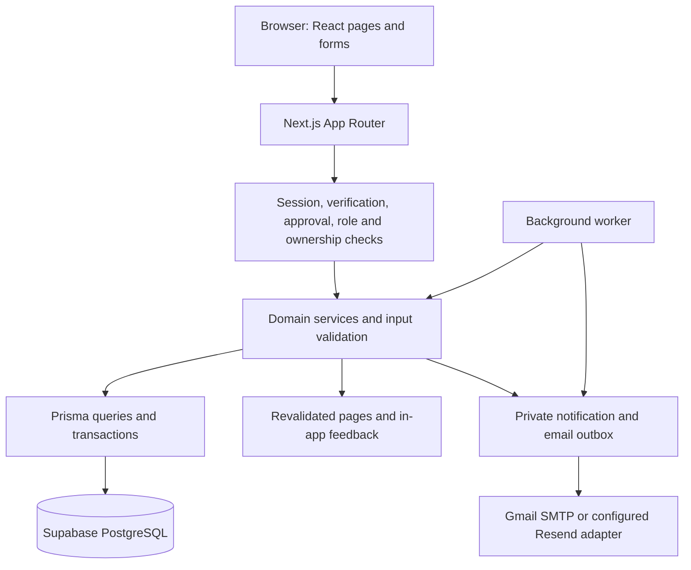

# Skyline Student Organization System

Skyline is a campus club workspace for memberships, events, QR tickets, merchandise, volunteer tasks, announcements and finances. It replaces scattered spreadsheets, notebooks and group messages with persistent records and role-controlled workflows.

This repository contains the **Student Organization System**, not LoomFlow. The application is in [`skyline/`](skyline/). Updated: **11 October 2026**.

## Actual technology stack

Versions below are resolved in [`skyline/package-lock.json`](skyline/package-lock.json), rather than the wider version ranges in package.json.

| Layer                    | Current implementation                                      | Responsibility                                                                               |
| ------------------------ | ----------------------------------------------------------- | -------------------------------------------------------------------------------------------- |
| Application framework    | **Next.js 15.5.27**, App Router                             | Routing, layouts, server rendering and the application server                                |
| Frontend                 | **React 18.3.1**, **TypeScript 5.9.3**                      | Typed pages, forms and interactive components                                                |
| Styling                  | **Tailwind CSS 3.4.19**, custom CSS                         | Responsive glass panels, desktop top navigation and mobile bottom navigation                 |
| Icons and style helpers  | **Lucide React 0.468.0**, CVA, clsx, tailwind-merge         | Icons and reusable component styling                                                         |
| Backend                  | **Node.js**, Next.js Server Actions and Route Handlers      | Domain rules, mutations, exports and protected job endpoints                                 |
| Database                 | **Supabase-hosted PostgreSQL**                              | Persistent accounts, memberships, events, tickets, orders, tasks and ledger records          |
| Receipt files            | **Supabase Storage**, **@supabase/supabase-js 2.117.3**     | Private uploads and authorized claimant/Treasurer downloads                                  |
| ORM                      | **Prisma / Prisma Client 6.19.3**                           | Typed queries, transactions and conditional updates                                          |
| Validation               | **Zod 3.25.76**, shared validation helpers                  | Input bounds, dates, quantities, email and monetary values                                   |
| Authentication           | Custom database-backed opaque cookie sessions               | Login, session expiry and revocation; session tokens are hashed with SHA-256 in the database |
| Password protection      | Node.js crypto **scrypt** with random salts                 | Password hashing and verification                                                            |
| Authorization            | Server-side role, account-state and ownership checks        | MEMBER, STAFF, TREASURER; separate designated Staff approval capability                      |
| QR generation            | **qrcode.react 4.2.0**                                      | Digital ticket QR display                                                                    |
| QR scanning              | **@zxing/browser 0.1.5**                                    | Camera-based scanning, with manual ticket-code fallback                                      |
| Email                    | **Nodemailer 10.1.0**, Gmail SMTP; optional Resend adapter  | OTP, password recovery and queued notices/reminders                                          |
| Background processing    | **tsx 4.23.15** worker and protected Next.js job endpoint   | Event reminders, membership expiry, waitlist offers and queued email                         |
| Code quality             | **Prettier 3.9.10**, **ESLint 8.57.1**, TypeScript compiler | Formatting, lint and type checks                                                             |
| Verification             | Node assert-based integration scripts                       | Scoped temporary fixtures for domain and database behavior                                   |
| Collaboration            | Git and GitHub                                              | Local commits and shared source history                                                      |
| Payment integration code | Razorpay **Test Mode only**                                 | Existing event checkout work; development is paused and not a completed live payment system  |

The local runtime used for the latest verification is **Node.js v24.14.1**. Install dependencies with `npm ci` to use the committed lockfile.

There is **no Python backend, Express server, JWT authentication, Supabase Auth, Odoo runtime, or installed shadcn/ui component library** in the current implementation. Next.js hosts frontend and backend together as a modular monolith. The UI uses custom reusable components. Page refresh/polling where implemented is not a Supabase Realtime subscription.

### Why the schema still mentions SQLite

[`skyline/prisma/schema.prisma`](skyline/prisma/schema.prisma) is the base schema. [`skyline/scripts/database.mjs`](skyline/scripts/database.mjs) selects the provider from private configuration and generates an ignored PostgreSQL schema when `DATABASE_PROVIDER=postgresql`.

**The current configured database is Supabase PostgreSQL.** The checked-in `.env.example` defaults to SQLite for a fresh standalone setup; copying it does not reproduce the configured Supabase environment. Use the project's `db:*` commands so Prisma targets the selected provider.

## Architecture and data flow



React Server Components fetch data on the server. Server Actions validate the signed-in actor and input before changing records. Route Handlers provide attendee CSV/calendar exports, protected jobs and the existing test payment webhook. Database and email credentials stay on the server.

## Implemented club workflows

Business records are entered through the application and stored in the database. Empty views remain empty until records are created; startup does not populate demo events, products or transactions.

| Module            | Functioning behavior                                                                                                                      | Important boundary                                                                                                         |
| ----------------- | ----------------------------------------------------------------------------------------------------------------------------------------- | -------------------------------------------------------------------------------------------------------------------------- |
| Accounts          | Registration with requested role, login/logout, OTP verification logic, recovery flows, account preferences and designated Staff approval | New users need verified email and approval; real OTP inbox delivery still needs acceptance testing                         |
| Membership        | Member directory, dues setup, recording separately received dues, annual validity, early renewal and expiry/reminder processing           | Account registration alone does not grant paid membership; dues recording does not collect money online                    |
| Events            | Staff creation/editing, registration dates, member/non-member pricing, capacity checks, attendee tracking and CSV/calendar export         | Practice ticket registration is not a real financial charge                                                                |
| Tickets and entry | Own ticket view, QR/backup code, print/download, cancellation and Staff check-in                                                          | Scanning fills the code; Staff confirms entry. Atomic status changes reject duplicate, cancelled and wrong-event admission |
| Waitlists         | Queue positions, seat offers, offer expiry and reminder notifications                                                                     | Unattended processing requires the worker or configured protected job trigger                                              |
| Merchandise       | Size/quantity selection, stock decrement, active-member pricing, owned order history and Staff collection recording                       | Practice order/payment records; no online shop payment collection or shipping integration                                  |
| Volunteers        | Staff task creation, assignments, deadlines and TODO / DOING / DONE progress tracking                                                     | Volunteers are participants in the task workflow, not a separate authentication role                                       |
| Announcements     | Dated notice archive, personal notification fan-out and opted-in email queue                                                              | Background delivery and actual recipient inbox receipt must be verified                                                    |
| Finance           | Dues/ticket/merchandise/fundraiser categories, expense requests, Treasurer review and currency-separated balances                         | Approval records an expense, not a bank payout; private files and HTTPS links are supported                                |

### Roles and access

| Role                       | Landing route  | Main permissions                                                                                                                                                                  |
| -------------------------- | -------------- | --------------------------------------------------------------------------------------------------------------------------------------------------------------------------------- |
| Member / Student           | `/my-events`   | Browse events, manage own registrations/tickets, place club shop orders, view tasks/notices, submit own expense requests and manage account preferences                           |
| Staff                      | `/`            | Manage events/attendees, verify entry, manage inventory/collection, member dues, volunteer tasks and announcements                                                                |
| Treasurer                  | `/treasurer`   | Review another user's expense requests, record fundraiser receipts, manage membership dues and inspect currency-separated finances; cannot place shop orders or use the door desk |
| Designated approving Staff | `/admin/users` | Approve/reject every requested role after email verification; ordinary Staff does not automatically gain this capability                                                          |
| Public visitor             | `/events`      | Browse event listings/details and access sign-in/registration                                                                                                                     |

Selecting a role at registration is a **request**, not an immediate permission grant. Ownership checks protect private tickets, orders and claims. A Treasurer may attend an event and view their own ticket; that does not grant permission to scan and record admission.

The initial accounts already exist in the configured database. Passwords are intentionally absent from source documentation. Normal browser tabs share session cookies: sign out between role checks or use separate browser sessions.

### Navigation and routes

Desktop uses a top navigation bar; phones use a fixed bottom bar. Four frequent destinations are visible for each role. **More** holds the remaining permitted pages. Account, updates and sign-out controls remain in the header.

| Area                        | Routes                                                                                                              |
| --------------------------- | ------------------------------------------------------------------------------------------------------------------- |
| Authentication and access   | `/login`, `/register`, `/verify-email`, `/forgot-password`, `/reset-password`, `/access-status`, `/access-denied`   |
| Overview and members        | `/`, `/members`                                                                                                     |
| Events and tickets          | `/events`, `/events/[eventId]`, `/events/[eventId]/manage`, `/events/check-in`, `/my-events`, `/tickets/[ticketId]` |
| Club operations             | `/merchandise`, `/fundraisers`, `/announcements`, `/treasurer`                                                      |
| Personal and administration | `/account`, `/notifications`, `/admin/users`                                                                        |
| Existing test payment pages | `/payments`, `/payments/[paymentId]`, `/admin/payments`                                                             |

The More disclosure closes after navigation, outside click or Escape. Navigation visibility complements server authorization; hiding a link is not the security boundary.

## Run locally

### Existing configured local clone

Open PowerShell:

```powershell
cd E:\Odoo-apex-main\Odoo-apex-main\skyline
npm run dev -- --port 3001
```

Open **http://localhost:3001/login**. Stop the app with **Ctrl+C**. Keep only one Skyline app server on that port.

### First run after cloning

```powershell
git clone https://github.com/maheshwaran6953/Odoo-apex.git
cd Odoo-apex\skyline
```

Keep an existing private `.env`. Only if it does not exist, create it from the example:

```powershell
if (-not (Test-Path -LiteralPath .env)) {
    Copy-Item -LiteralPath .env.example -Destination .env
}
```

Configure the private values described below **before** installation/generation, then run:

```powershell
npm ci
npm run db:generate
npm run db:validate
npm run dev -- --port 3001
```

Installation also generates Prisma Client through `postinstall`. The explicit generate command is useful if Prisma reports that its client has not initialized. Internet access is needed for installation, Supabase and external email.

Do **not** run seed, reset, import or bootstrap during ordinary startup. `npm run db:seed` is disabled. The configured database already contains accounts and user-entered records. A genuinely empty database needs intentional schema setup and initial Staff bootstrap using the [local runbook](docs/LOCAL_RUNBOOK.md).

### Private environment configuration

Configure [`skyline/.env.example`](skyline/.env.example) values in the ignored `skyline/.env`; never put secrets in Git or documentation.

| Variable                                | Purpose                                                                                         |
| --------------------------------------- | ----------------------------------------------------------------------------------------------- |
| `DATABASE_PROVIDER`                     | `postgresql` for the current Supabase database                                                  |
| `DATABASE_URL`                          | Private runtime PostgreSQL connection string                                                    |
| `DIRECT_URL`                            | Private reachable schema-management connection string                                           |
| `APP_URL`                               | `http://localhost:3001` locally                                                                 |
| `EMAIL_PROVIDER`                        | `smtp` for the current Gmail configuration; `resend` is the optional alternative                |
| `SMTP_HOST`, `SMTP_PORT`, `SMTP_SECURE` | Current Gmail values: `smtp.gmail.com`, `465`, `true`                                           |
| `SMTP_USER`, `SMTP_PASSWORD`            | Sending mailbox and Google App Password                                                         |
| `EMAIL_FROM`                            | Sender; must match `SMTP_USER` for Gmail                                                        |
| `OTP_SECRET`                            | Private stable secret of at least 32 characters                                                 |
| `EMAIL_VERIFICATION_ENABLED`            | `true` in the current local configuration; keep verification gated until delivery is configured |
| `RESEND_API_KEY`                        | Needed only when selecting the Resend adapter with an appropriate sender                        |
| `CRON_SECRET`                           | Needed when using the protected background-job HTTP endpoint                                    |

Existing `RAZORPAY_*` configuration is for paused Test Mode work. Do not switch to Live Mode as part of setup. A Supabase project URL alone is not a database connection string.

Only when intentionally applying reviewed schema changes:

```powershell
npm run db:push
```

This wrapper also applies server-only Supabase table access restrictions. Schema push is the current mechanism; versioned production migrations remain future hardening. It is not a normal startup command.

### Background processing

In a second terminal from the `skyline` folder:

```powershell
npm run events:watch
```

The worker processes immediately and then approximately every five minutes. It handles event reminders, waitlist offers/expiry, membership processing and queued messages. It also invokes existing test-payment reconciliation logic. A single pass is `npm run events:jobs`.

Registration/resend attempts immediate OTP delivery independently. Running the web server alone does not run unattended reminder jobs. Stop the worker with **Ctrl+C** when it is no longer needed.

### Production-style local run

Stop the current app server before rebuilding:

```powershell
npm run build
npm run start -- --port 3001
```

`start` requires a successful build and does not watch source changes. Do not run `dev` and `start` on the same port, or overwrite `.next` while its server is running. Stop app/worker processes before reinstalling or regenerating Prisma on Windows to avoid file locks.

## Repository structure

```text
Odoo-apex/
├── README.md
├── reference.md                     # Commands, stack, roles and operating flows
├── docs/                            # Runbook, coverage and verification evidence
└── skyline/
    ├── package.json
    ├── package-lock.json
    ├── .env.example                 # Configuration template; no real secrets
    ├── prisma/schema.prisma         # Base schema; provider wrapper selects PostgreSQL
    ├── scripts/                     # Database, worker, email and verification commands
    └── src/
        ├── app/                     # App Router pages, layouts and API Route Handlers
        ├── components/club/         # Reusable UI, navigation, forms and scanners
        ├── server/actions/          # Server Actions grouped by domain
        ├── server/                  # Account, OTP, event, club, finance and payment services
        ├── lib/                     # Prisma client, validation and password helpers
        └── middleware.ts            # Request middleware
```

## Verification and current limits

From `skyline`:

```powershell
npm run format:check
npm run lint
npm run typecheck
npm run build
```

The latest implementation checks passed. Service verification commands are `verify:basics`, `verify:events`, `verify:finance`, `verify:otp` and `verify:email`. These create scoped temporary records in the configured database and clean their exact fixtures; prefer an isolated test database for repeated checks. `verify:email` uses simulated delivery and does not establish real inbox arrival.

- Gmail SMTP connection/TLS/authentication passed `npm run email:check`; one authorized test email reached Inbox; registration OTP, reset and reminder journeys still need their own acceptance.
- Razorpay work is paused. Public webhook delivery and refunds remain unresolved; real online collection, shop payment and bank payouts are not complete.
- Physical QR-camera/device acceptance and a verified public deployment remain pending. Camera access requires HTTPS or localhost.
- Private receipts use Supabase Storage (PDF/PNG/JPEG, max 2 MB) and authorized claimant/Treasurer downloads. Validated external HTTPS links remain optional; do not supply both.
- The deployment branch upgrades Next.js to 15.5.27 and pins patched transitive dependencies; production dependency audit reports zero findings. Development-tool advisories remain separately tracked. Versioned migrations, backup restore rehearsal and deployment-specific abuse protection also remain hardening work.

See [repair verification](docs/REPAIR_VERIFICATION.md) for completed checks and boundaries. Exact usage of the new controls is in [operational features](docs/OPERATIONAL_FEATURES.md).

## Completion and manual acceptance

Use [the completion checklist](docs/COMPLETION_CHECKLIST.md) for remaining work and [the manual testing guide](docs/MANUAL_TESTING_GUIDE.md) for 91 numbered cases covering current workflows, permissions, edge cases and external acceptance. Record executed results in [the test log](docs/MANUAL_TEST_RESULTS.md); creating these documents does not mean the tests passed. Attendee-export account-state/currency repairs and operational enhancements are implemented; the checklist separates service results from incomplete manual/production gates. Gateway execution remains deferred.

## Further documentation

- [Local reference](reference.md): run commands, actual stack, roles and end-to-end flows.
- [Local runbook](docs/LOCAL_RUNBOOK.md): setup, accounts, worker operation and troubleshooting.
- [Original problem-statement coverage](docs/PROBLEM_STATEMENT_TECH_STACK.md): requirement-by-requirement implementation matrix.
- [Email verification](docs/EMAIL_VERIFICATION.md): provider configuration and OTP acceptance steps.
- [Repair verification](docs/REPAIR_VERIFICATION.md): implementation checks and outstanding acceptance work.
- [Payment documentation](docs/PAYMENTS.md): existing paused Test Mode integration.

Older planning/review documents record previous states. Use this README, the local reference and repair verification for the current implementation.

## New operational controls

- Assigned volunteers update only their own task status; Staff manages all tasks.
- Treasurer filters dates, currency, category, status, type and description; CSV includes all matching entries up to 10,000. Table pagination uses 25 rows.
- Staff receives/corrects merchandise stock with audited quantity deltas and retry protection.
- Expense claims accept a private PDF, PNG or JPEG up to 2 MB; uploaded receipts download only to the claimant or approved Treasurer. Identical submission retries cannot create another claim.
- Campus timestamps default to Asia/Kolkata; finance date filters and CSV timestamps use labelled UTC.
- Pending/unverified accounts can browse public events; operational actions remain protected.

Run npm run storage:setup after privately configuring SUPABASE_URL, SUPABASE_SERVICE_ROLE_KEY and SUPABASE_RECEIPTS_BUCKET. Never expose server keys in NEXT_PUBLIC variables. Bucket setup and real upload/download/HTTP authorization checks passed.

See [the operational guide](docs/OPERATIONAL_FEATURES.md) and manual cases TC82–TC91. New checks: npm run verify:operations; npm run verify:receipts -- --base-url http://localhost:3001 (explicit real temporary upload, requires the running app). Payment work remains paused.
