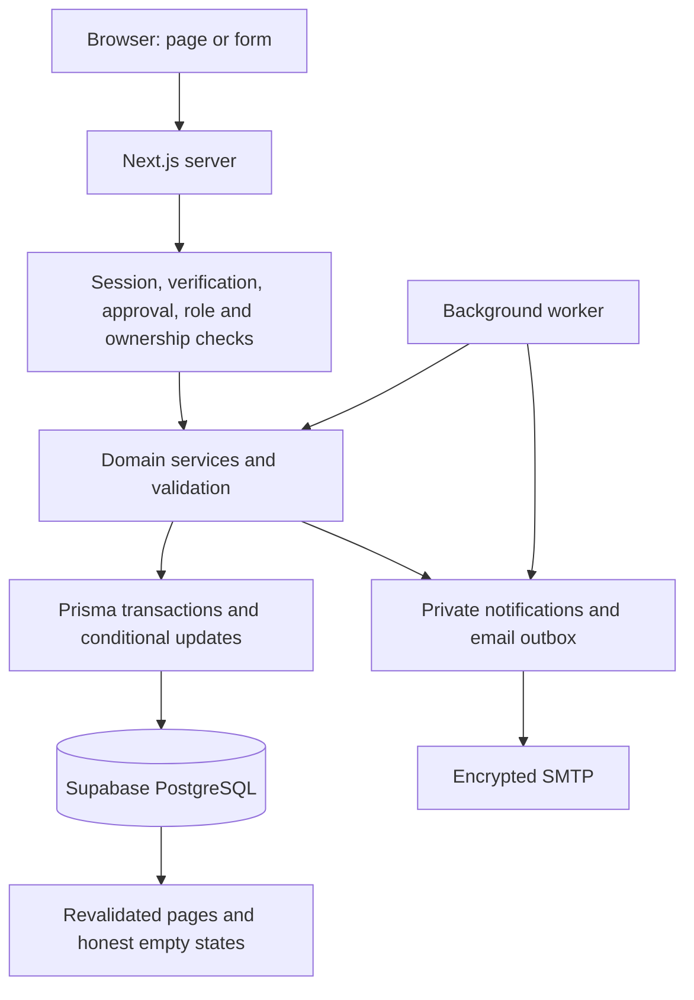

# Skyline — Problem Statement Coverage and Technology Stack

Updated: 11 October 2026.

## Source and scope

Source: the original four-page Student Organization System PDF at `E:\Projects\Odoo\Student_Organization_System.pdf`. This is the Skyline campus club project. The PDF asks for one place to manage members, events and money through six semester scenarios. It does not require LoomFlow, manufacturing modules, microservices, an Express backend or an Odoo runtime.

The implementation remains a Next.js modular monolith. Existing UI styling is retained. New controls fill functional gaps using existing components. Business records are entered dynamically, not generated from demo arrays. Payment integration remains paused by the owner's instruction: ticket/shop payment collection is not marked complete.

## Actual technology stack

| Layer | Actual technology | Responsibility |
| --- | --- | --- |
| UI and routing | Next.js 14 App Router, React 18, TypeScript 5 | Pages, layouts, forms and typed interactive controls |
| Presentation | Tailwind CSS 3, custom CSS, Lucide React, CVA/clsx/tailwind-merge | Existing responsive glass-style interface and component styling |
| Server reads | React Server Components | Read current database records on the server |
| Server writes | Next.js Server Actions | Validate actors/inputs, invoke domain services and revalidate pages |
| HTTP endpoints | Next.js Route Handlers | Attendee CSV/calendar export, protected jobs and existing paused payment webhook |
| Runtime | Node.js | Next.js server, worker and crypto/email libraries |
| Data | Supabase PostgreSQL | Persistent users, membership, events, orders, tasks and finance |
| ORM | Prisma 6.19.3 | Typed queries, conditional updates and transactions |
| Input constraints | Zod 3 and shared validation helpers | Bounds, exact decimal money, dates, identifiers and permitted values |
| Authentication | Custom opaque cookie sessions, server token hashes, scrypt password hashes | Login identity, expiry/revocation; not JWT or Supabase Auth |
| Authorization | Server role/account checks plus record ownership | MEMBER, STAFF, TREASURER; designated Staff approval capability |
| Ticket QR | qrcode.react and @zxing/browser | Ticket QR rendering and camera scanning |
| Messaging | Private database outbox, Nodemailer/Gmail SMTP, optional Resend adapter | OTP, account recovery, notices, reminders and updates |
| Scheduling | tsx background worker, optional secret-protected job endpoint | Five-minute processing of event/membership jobs and mail queue |
| Code quality | Prettier 3, ESLint 8, TypeScript compiler | Readable style, lint and type safety |
| Verification | Node assert-based scoped integration scripts | Test actual service/database behavior with temporary records |
| Collaboration | Git and GitHub | Reviewable local commits and shared source |

The checked-in Prisma base schema still names SQLite. `scripts/database.mjs` generates the PostgreSQL schema according to `DATABASE_PROVIDER=postgresql`; the current database is Supabase PostgreSQL. Use `npm run db:generate`, `db:validate` and the intentional `db:push` workflow rather than targeting the base schema directly.

## Data and authorization flow



No browser connection exposes database or SMTP credentials. Public Supabase table access is restricted; server code performs the queries. UI polling where implemented is distinct from a database realtime subscription.

## Requirement-by-requirement coverage

| Original requirement | Implementation and destination | Stack / integrity rule | Evidence and limit |
| --- | --- | --- | --- |
| Identify a student joining the club, page 2 | Registration, account approval and `/members` directory | User/Member linkage, server session, validated unique email | Existing registration/RBAC; dues setup gap repaired |
| Track whether dues were paid, page 2 | Staff/Treasurer set annual dues and record separately received payment | Membership + DUES ledger record in one transaction | Concurrent recording allows one posting; setting dues alone grants no paid status |
| Annual expiration and reminder before lapse, page 2 | 30-day renewal notification/mail queue; worker marks expired records; status and expiry in account/directory | Idempotent keys per membership/expiry/stage; stale mail canceled | New fixtures cover repeat processing, expiry, early renewal and obsolete messages; inbox arrival pending |
| Renew before membership lapses, page 2 | Record renewal within 30 days of expiry | One additional year from current paid-through date; concurrent/repeat guard | New early-renewal check verifies paid time preserved |
| Membership benefits on tickets and merchandise, page 2 | Event member tiers; optional per-size active-member shop price | Server checks ACTIVE membership and future expiry, snapshots order/ticket price | Event tests plus new shop eligibility/expired-membership checks |
| Online event registration and member/non-member prices, page 2 | `/events`, event detail, `/my-events`, own QR ticket | Session-bound identity, event capacity transactions, unique registration | Registration/tiering implemented; actual online collection remains deferred |
| Seat availability limit, page 2 | Capacity/deadline rules plus waitlist offers | Serialized event mutations, active holds/offers included | Existing concurrent last-seat checks; no overbooking claim based only on UI |
| Fast digital check-in without paper, page 2 | Staff-only `/events/check-in`; QR or manual code | Selected event, permitted time window, atomic PAID → CHECKED_IN | Duplicate/concurrent/canceled/wrong-event checks; physical camera/device acceptance pending |
| Attendance and event earnings after the event, page 2 | Staff event management attendance and ticket-value summary | Ticket statuses, timestamps and stored price; finance categories | Attendance persists; practice ticket value is simulated, not gateway settlement or net event profit |
| One announcement with a dated record, page 3 | `/announcements` archive and publication | Announcement table, publication timestamp, bounded text | Existing archive; publication now uses a stable submission key |
| Mailing list reaching members, page 3 | Publication saves personal updates and queues opted-in account emails | Verified approved enabled accounts only; unique notice/recipient keys | New tests cover audience, repeat publication and opt-out before delivery; worker/inbox still required |
| Collect hoodie/T-shirt sizes and orders, page 3 | `/merchandise` size selection, quantities and personal order history | Inventory variants, order lines and stored unit prices | Persistent dynamic records; Staff sees club orders, other roles see their own |
| Know remaining stock per size, page 3 | Stock labels and validated ordering | Conditional stock decrement and order/ledger transaction | New concurrent last-unit and invalid-quantity checks |
| Track merchandise collection, supports page 3 | Staff Mark collected; own order collection timestamp | PAID → FULFILLED conditional transition | Repeat collection does not decrement stock or record income again |
| Take online merchandise payment, page 3 | Practice order path currently | Existing gateway work is event-focused and paused | NOT complete: no online shop payment collected; no shipping integration required by this PDF |
| Split volunteer tasks and track who/what/status, page 3 | `/fundraisers`, assignment, due dates, TODO/DOING/DONE | Task/Member relation, Staff-only mutation and validated inputs | Existing board; page caches now revalidated after changes |
| Include fundraiser receipts in the club budget, pages 1/3/4 | Treasurer records description, actual receipts and currency | FUNDRAISER income with stable submission key | New duplicate/concurrent posting and Treasurer-only checks; records money already received, does not collect it |
| Review reimbursement requests and receipts, pages 1/4 | Own account expense request, optional HTTPS receipt link, Treasurer review | Claimant/reviewer ownership, safe link metadata, single review decision | Existing approval checks plus new safe-link checks; no upload/storage service or bank payout claimed |
| Explain all incoming/outgoing money and remaining balance, page 4 | Treasurer ledger and shared currency-separated totals | DUES/TICKET/MERCHANDISE/FUNDRAISER/REIMBURSEMENT categories; integer minor units | Existing finance suite; pending/rejected/void/test records excluded as defined; practice postings are not verified bank cash |
| Work from a student's phone, page 3 | Responsive existing forms/cards/table scrolling | Existing responsive CSS and browser controls | Build does not substitute for full real-device acceptance |

## Additions made by this audit

1. Membership dues setup for account-created directory records, with no fabricated default dues.
2. Expiry processing and renewal notifications/mail queue, including early renewal without lost paid time.
3. Announcement fan-out, opt-out checks and duplicate-publication prevention.
4. Optional persisted member price per stock variant, decided again on the server at ordering time.
5. Owned order history and Staff collection recording without repeated financial effects.
6. Treasurer fundraiser income entry with amount/currency and duplicate-submission protection.
7. Optional validated HTTPS receipt metadata visible to claimant and reviewer. No file upload or server fetching of external receipt URLs.
8. Cache revalidation and worker/job integration for the new behavior.
9. Scoped verification script `npm run verify:basics`, with no real provider email dispatch.

Two additive database fields: `InventoryItem.memberPriceCents` (nullable; old items have no discount) and `MerchandiseOrder.fulfilledAt` (nullable). Existing records were preserved; a private 20-table backup was taken before applying them. No reset or production seed was run.

## Roles and destinations

- Member: own registrations/tickets, orders, expenses, account and updates; landing `/my-events`.
- Staff: events, door desk, inventory/collection, membership operations, task board and notices; landing `/`.
- Treasurer: dues, notices and finance/reimbursement review; landing `/treasurer`. A Treasurer cannot approve their own claim or place a shop order.
- Designated initial Staff only: `/admin/users`, reviewing every requested role after email verification. Ordinary Staff does not inherit approval power.
- Directory records without a linked verified approved user do not receive account notifications. They must register/link an account; this is not an unrestricted bulk-email tool for imported addresses.
- Email updates can be opted out of; required verification/reset messages use their separate account workflows. Publication records remain available on the noticeboard.

## Basic local run

```powershell
cd E:\Odoo-apex-main\Odoo-apex-main\skyline
npm run dev -- --port 3001
```

Open http://localhost:3001/login. In a second terminal from the same folder:

```powershell
npm run events:watch
```

OTP issuance attempts its own immediate message; event/membership reminders and announcement mailing need background processing. Keep only one app server on this port. Stop app and worker before reinstalling/regenerating Prisma on Windows, and stop a production server before rebuilding its `.next` output.

See `../reference.md` for complete install commands, account emails, recovery and troubleshooting. Credentials stay only in private `.env`/bootstrap files.

## Verification and remaining gates

The implementation is checked with formatting, TypeScript, lint, production build and scoped database scripts. The new suite checks dues/early renewal/expiry, notice recipient restrictions, stock races, discount snapshots, repeated collection, fundraiser duplicate posting, safe receipt metadata and exact cleanup. It does not send actual emails.

Email SMTP authentication has passed locally; actual OTP, notices, renewal and reminder inbox acceptance remains to be confirmed. Real QR-camera acceptance and browser journeys also require device testing. Payment gateway/refund/public-webhook work is paused. The older framework dependency advisories, production migration process and backup restore rehearsal remain documented release concerns.

The basic operational workflows can therefore be exercised locally with persisted data. **Full original online payment collection and independently verified external delivery are not complete.** Do not present practice ledger values as settled money or queued messages as received email.
